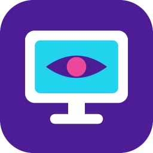

<h1 align="center">Xviews</h1>

Kleine, kostenlose Windows-Tools. Ohne Konto, ohne Werbung, ohne Schnickschnack.

| | Projekt | Worum geht's? | |
|:-:|---|---|---|
|  | **[Xviews&nbsp;Stickpilot](https://github.com/xviews/xviews-stickpilot)** | Der Tesla-USB-Stick, einfach gemacht: einrichten, befüllen, prüfen. Mit Kennzeichen-Generator und Dashcam-Viewer mit Fahrdaten. |  |
|  | **[Xviews&nbsp;Glotzofon](https://github.com/xviews/xviews-glotzofon)** | Bildschirm kurz zeigen, ohne Fernwartungs-App: Code weitergeben, Freunde schauen in der App zu. |  |
|  | **[Xviews&nbsp;PinWatch&nbsp;Widget](https://github.com/xviews/xviews-pinwatch-widget)** | Das Thermal Grizzly WireView Pro II live auf dem Display der CORSAIR VANGUARD 96. Inoffizielles Community-Projekt. |  |
|  | **[Michi's&nbsp;Umzugskiste](https://github.com/xviews/xviews-umzugskiste)** | Umzug auf einen neuen PC, ohne etwas zu vergessen: persönliche Daten finden, auf USB-Stick sichern und wiederherstellen. |  |
|  | **[Xviews&nbsp;LG&nbsp;ModApp](https://github.com/xviews/xviews-lg-modapp)** | Mehr aus dem gerooteten LG-TV holen: Werbung und Firmware-Updates blocken, LG-Apps ausblenden, Tasten der Fernbedienung neu belegen. |  |
|  | **[Xviews&nbsp;Paperless&nbsp;KI-OCR](https://github.com/xviews/xviews-paperless-ki-ocr)** | Lokale KI-Texterkennung für Paperless-ngx: liest deine Scans mit Ollama oder LM Studio statt mit Tesseract, komplett auf deinem PC. |  |

Fehler gefunden oder eine Idee? Einfach im jeweiligen Projekt unter „Issues“ melden.

